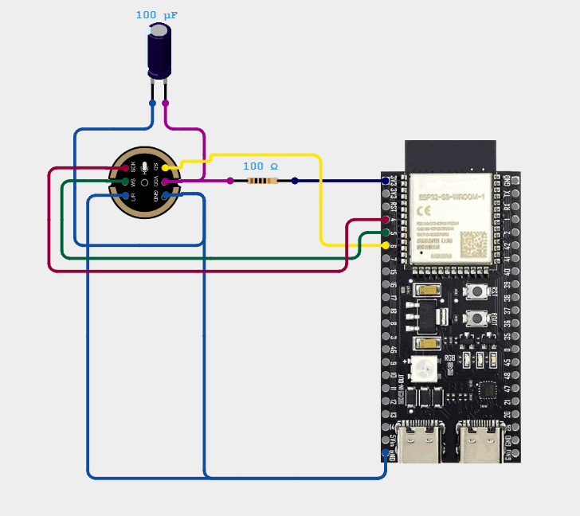

# DIY USB Microphone (ESP32-S3 + INMP441)

A plug-and-play USB microphone for about 60 DT. Plug it into a PC or an iPhone and it shows up as a normal microphone. No drivers and no app needed.

Built by Mahdi · Instagram [@majjcrafts](https://instagram.com/majjcrafts)

## How it works

1. The **INMP441** is a digital MEMS microphone. It sends audio over **I2S**, so there's no analog signal for noise to get into.
2. The **ESP32-S3** reads it at 48 kHz, applies the gain and a **90 Hz high-pass filter** to remove rumble, and converts it to 16-bit mono.
3. Espressif's `usb_device_uac` component makes the S3 a standard **USB Audio Class** device, so Windows, macOS, Linux, Android and USB-C iPhones detect it on their own.
4. A **100 Ω + 100 µF RC filter** on the mic's power line removes electrical noise coming from USB.

## Results

Same sentence, same distance, same room:

| | Phone mic | DIY, no filters | DIY, with both filters |
|---|---|---|---|
| Voice-to-noise | ~36 dB | ~33 dB | **~38 dB** |
| Background noise | -68 dB | -53 dB | -63 dB |

## Parts

- ESP32-S3 board (needs native USB: DevKitC-1, Super Mini or XIAO ESP32-S3)
- INMP441 I2S microphone module
- 100 Ω resistor + 100 µF electrolytic capacitor
- Jumper wires / breadboard, USB-C cable

## Wiring

<!-- Wiring diagram: save it as docs/wiring.png -->


Pin table and power filter details: [docs/wiring.md](docs/wiring.md)

## Build and flash

Needs [ESP-IDF](https://docs.espressif.com/projects/esp-idf/en/latest/esp32s3/get-started/) v5.x.

```
idf.py set-target esp32s3
idf.py build
idf.py -p COMx flash
```

The `usb_device_uac` component downloads automatically on the first build. The USB audio settings (mono mic, 48 kHz, 16-bit) come from `sdkconfig.defaults`.

After flashing, plug the cable into the S3's **native USB** port (labelled "USB" on dual-port boards, not "UART" or "COM"). The board shows up as **"ESP UAC Device"**.

## Tuning

In `main/usb_mic.c`:

- `GAIN_SHIFT`: lower = louder. 13 is a good start. If it's too quiet try 12; if it distorts try 14.
- `PIN_SCK`, `PIN_WS`, `PIN_SD`: change these if you wire to other GPIOs.

## Tips

- The INMP441 is omnidirectional, so keep it 15–20 cm from your mouth.
- A bit of open-cell foam over the sound hole cuts "p" and "b" pops.
- If you hear a faint 50 Hz hum, unplug the laptop charger. It's usually a ground loop.

## License

MIT. Use it, remix it, and tag me if you build one.
